# StudentCheck

StudentCheck is a web app for taking class attendance with QR codes. Teachers
manage their disciplines (classes), start a scanner and read each student's QR
code; students see their own QR code and their attendance per discipline.

This repository is the static frontend (plain HTML, CSS and JavaScript modules,
no build step), served on Render. The API lives in
[studentcheck-server](https://github.com/Flame-Petrov/studentcheck-server).
The interface is available in Bulgarian and English.

## Screenshots

The screenshots below use sample data.

### Login

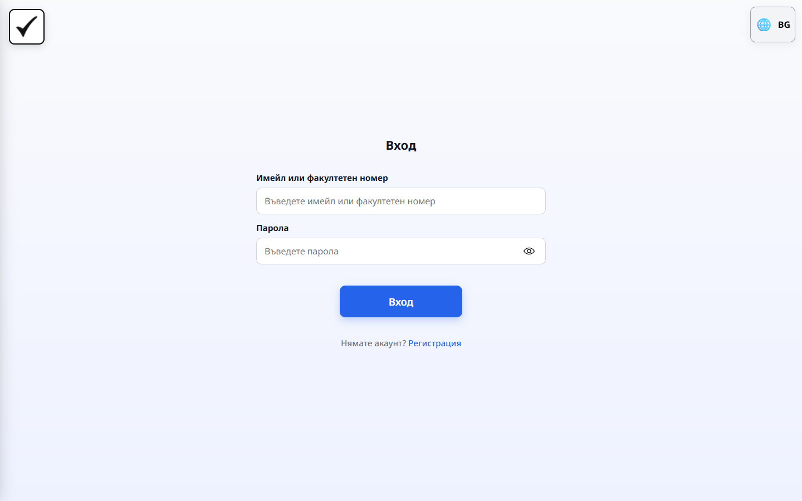

One login form for everyone: a 9-digit faculty number signs in a student, an
e-mail address signs in a teacher. While the request runs the form stays
visible and the button shows its progress.

### Teacher – Disciplines (Дисциплини)

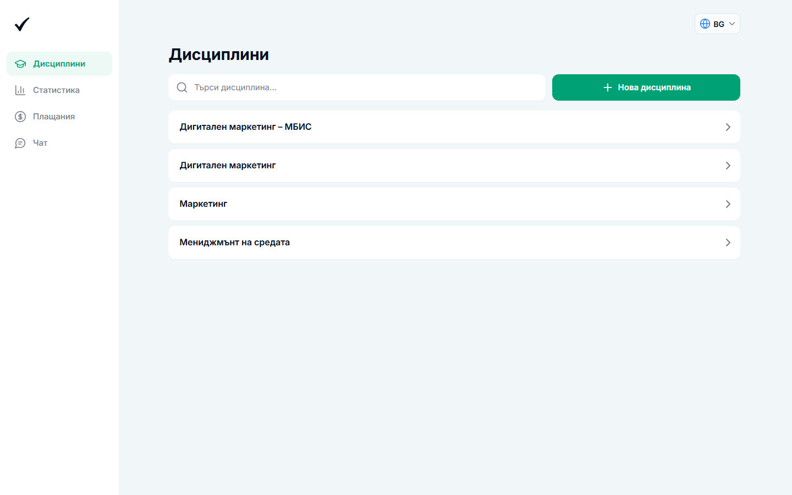

The teacher's home: every discipline as a card, with search and a
"Нова дисциплина" button that opens the creation wizard. The sidebar (Дисциплини,
Статистика, Плащания, Чат) and the language selector stay in place while moving
between sections.

### Teacher – Discipline menu

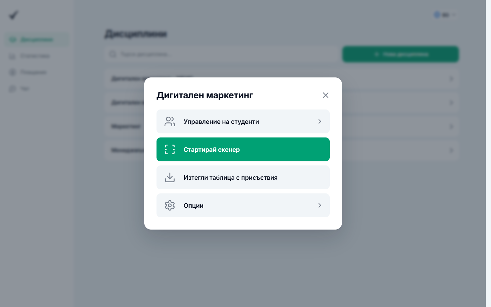

Clicking a discipline opens its menu: manage the enrolled students, start the
QR scanner, download the attendance table (.xlsx) or open the discipline's
options (rename / delete).

### Teacher – Statistics (Статистика)

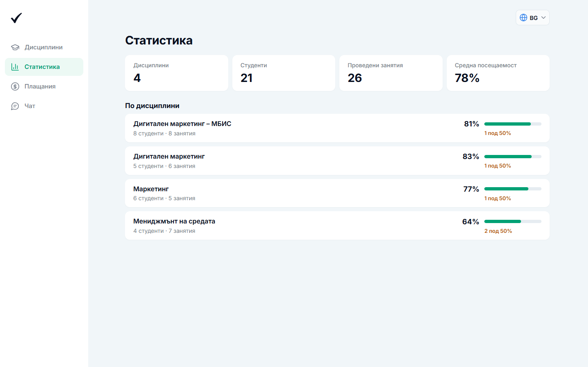

An overview across all disciplines: how many disciplines, students and lessons
there are and the average attendance. Below, each discipline with its number of
students and lessons, its average attendance, and how many students are under
50% attendance.

### Teacher – Payments (Плащания)

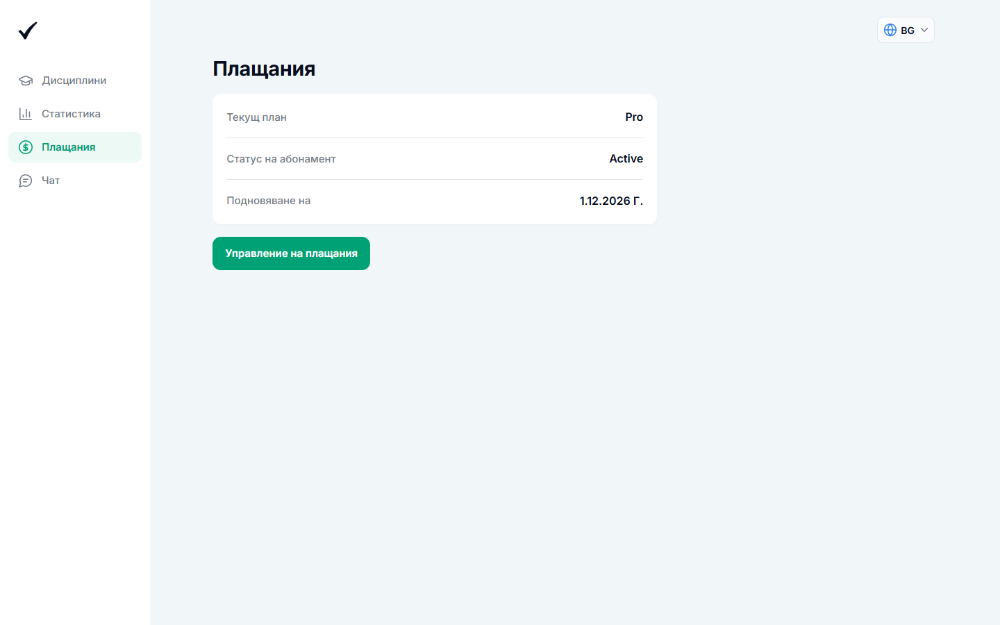

The current plan, subscription status and renewal date, with a button to the
Stripe billing portal.

### Teacher – Support chat

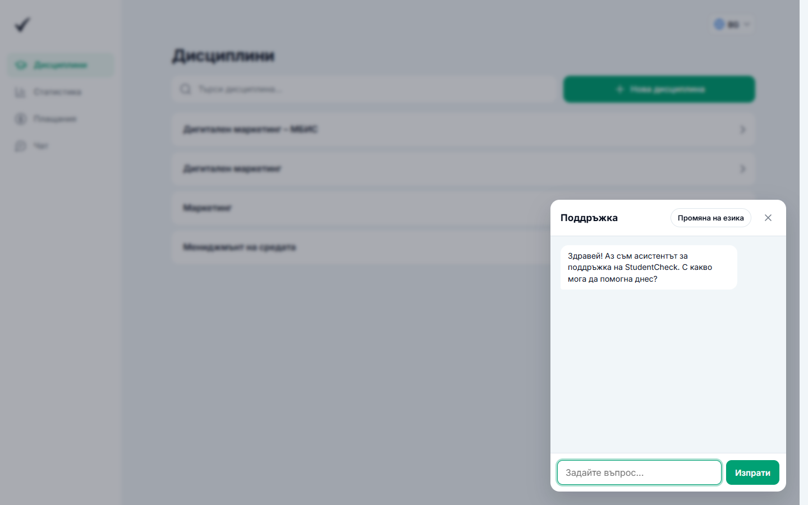

An assistant that answers questions about using StudentCheck, opened from
"Чат" in the navigation.

### Teacher – Loading state

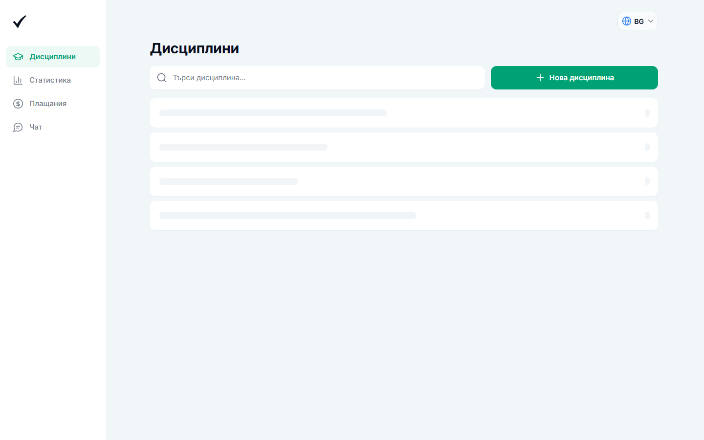

Before the data arrives the page already shows its layout with placeholder
cards (skeletons), so nothing jumps when the real content appears. Lists that
were loaded before are shown immediately from cache and refreshed in the
background.

### Teacher – Mobile

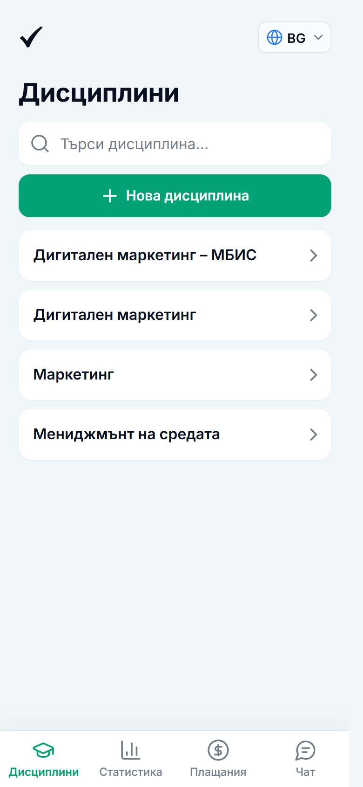

On phones the sidebar becomes a bottom navigation bar and the controls stack.

### Student – Courses

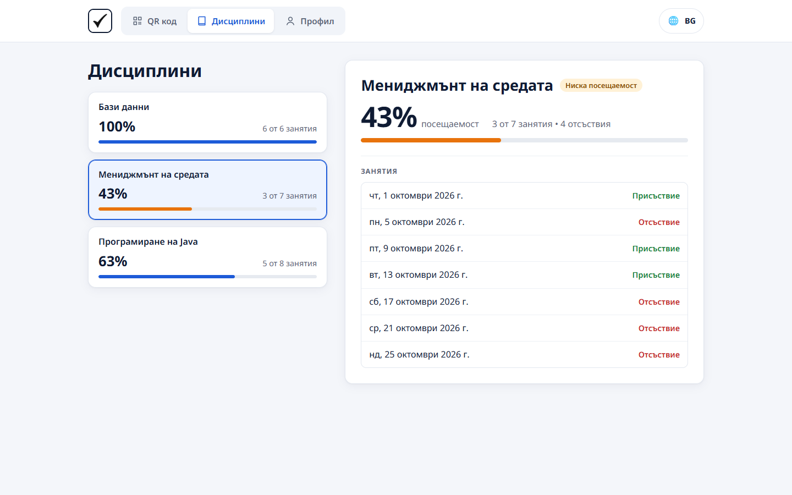

Each course with the student's attendance percentage; selecting one shows the
lessons and whether the student was present.

### Student – Profile

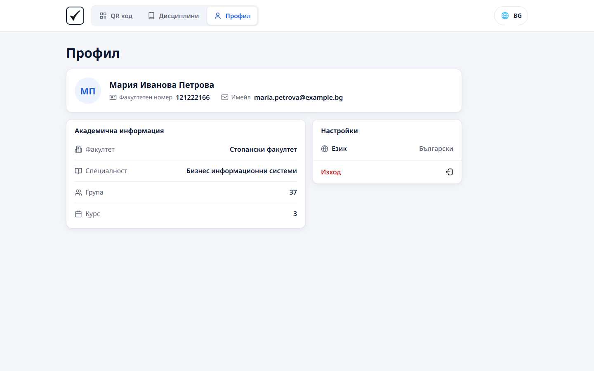

The student's details (faculty number, e-mail, faculty, specialization, group,
course) and settings for language and logging out.

### Student – Mobile

| QR code | Profile |
| --- | --- |
| 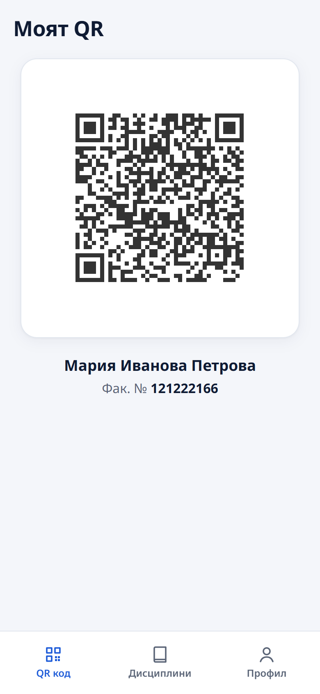 | 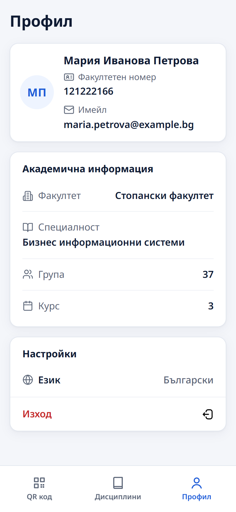 |

The QR code the teacher scans in class, and the profile, on a phone.

## Running locally

There is no build step: serve the folder with any static file server and open
`index.html`, for example:

```sh
python -m http.server 8000
```

The pages call the API at the address set in `javascript/config/api.js`.
